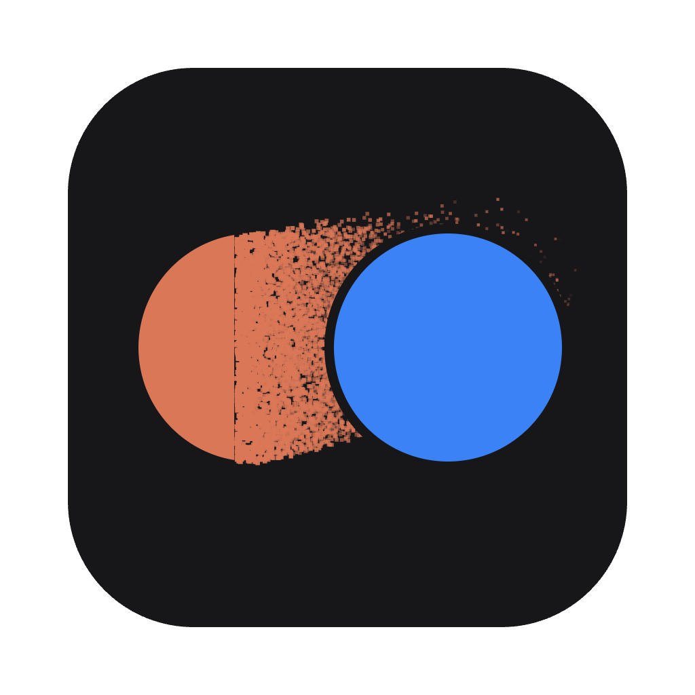

<p align="center"></p>

# Volte

Passe l'app de bureau Claude d'un compte à l'autre, sans se reconnecter. Site : [volte-lake.vercel.app](https://volte-lake.vercel.app)

L'app Claude ne garde qu'un compte à la fois : changer de compte, c'est se déconnecter puis se reconnecter. Volte donne à chaque compte son propre dossier de données et relance Claude sur le bon. Chaque compte reste connecté, avec son historique local, ses connecteurs et la position de sa fenêtre.

## Utilisation

- **⌘⌥C** (Mac) ou **Ctrl+Alt+C** (Windows) passe au compte suivant, depuis n'importe quelle app.
- Le menu de Volte, dans la barre de menus, liste les comptes et ouvre les réglages.
- Dans les réglages : ajouter des comptes, leur donner un nom, une photo, une couleur et un raccourci direct.

La première fois qu'un compte s'ouvre, Claude demande de se connecter. Ensuite, la session reste.

## Installation

Télécharge la dernière version sur la [page des versions](https://github.com/Luth-infinity/volte/releases/latest).

**Mac** : l'app n'est pas signée par Apple. Au premier lancement, macOS la bloque : ouvre **Réglages Système → Confidentialité et sécurité** et clique **Ouvrir quand même**. Ou dans le Terminal :

```bash
xattr -dr com.apple.quarantine /Applications/Volte.app
```

**Windows** : l'installeur n'est pas signé, Windows SmartScreen peut afficher un avertissement (**Informations complémentaires → Exécuter quand même**). La version Windows est un aperçu.

## Comment ça marche

Claude est une app Electron : elle accepte l'option `--user-data-dir`, qui choisit le dossier où elle range sa session. Le compte principal utilise le dossier par défaut de Claude, chaque autre compte un dossier `Claude-<nom>` à côté. Volte ferme Claude, recopie la position de la fenêtre, puis le relance sur le dossier du compte choisi. Une seule instance tourne à la fois, ce qui permet à la connexion par navigateur de revenir au bon endroit.

## Développement

```bash
npm install
npm start          # lance Volte
npm run check      # vérifications
npm run dist       # .dmg (Mac arm64 + Intel) et .exe (Windows)
```

---

Volte n'est pas affilié à Anthropic. Claude est une marque d'Anthropic.
